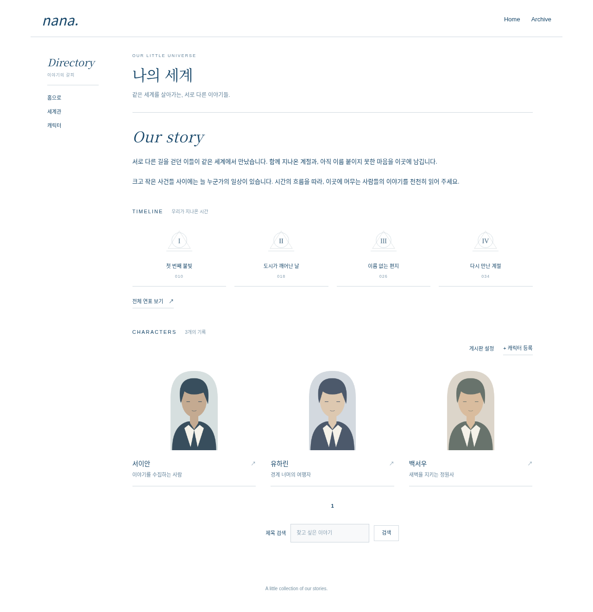
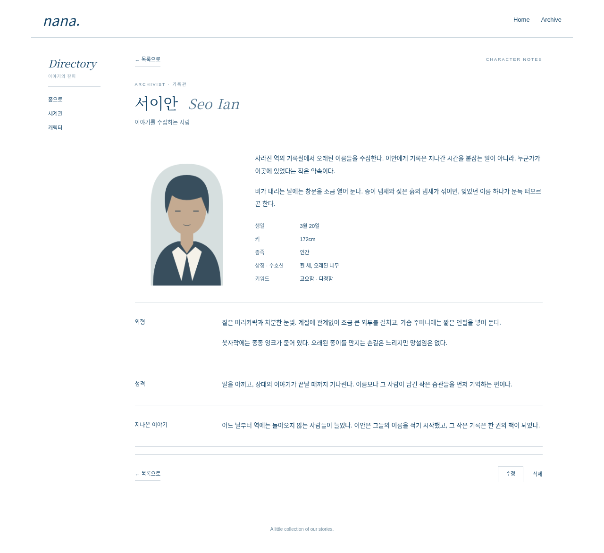

# 여백의 기록 — 아보카도 게시판 스킨 v2

PHP 7.4용 캐릭터 프로필·세계관 타임라인 스킨입니다.

**[스킨 ZIP 다운로드](https://github.com/tjfwlswn33-debug/nana/raw/refs/heads/main/dist/nana-board-skins-v2.zip)** · [설치·업데이트 안내](skin/INSTALL.md)

## v2 변경

- 목록 복귀 주소를 게시판 ID로 직접 생성하고 검색·분류·페이지를 유지
- 기존 개인홈의 배경·글자색·글꼴을 상속하는 투명한 디자인
- 소개글 → 연표 이미지 → 캐릭터 목록을 한 화면에 구성
- 게시판 내 Directory 메뉴, 모바일에서는 가로 메뉴
- 캐릭터 상세: 이름·초상·소개·기본 정보와 소제목별 긴 본문
- PHP 7.4 검사 및 Chromium의 모바일·데스크톱·iframe 탐색 검사

## 설치

ZIP의 `skin/board/nana_character`, `skin/board/nana_timeline`을 아보카도 서버의 같은 경로에 업로드하고 게시판 관리자에서 선택합니다. 기존 버전은 먼저 백업하세요. 루트 `index.php`, `main.php`, `head.php`, `tail.php`는 교체하지 않습니다.

`settings.local.php`에 소개글과 실제 캐릭터·연표 게시판 ID를 지정하면 연표 미리보기와 상호 이동 메뉴를 사용할 수 있습니다. 설정 예시는 설치 안내에 있습니다. 기존 테마 메뉴가 보이면 보조 메뉴를 끌 수 있습니다.

## 화면 예시

테스트용 콘텐츠·임시 헤더를 사용한 이미지입니다. 사용자 사이트의 실제 캐릭터·테마 화면이 아닙니다.





## 검증

```sh
docker run --rm -v "$PWD:/app:ro" -w /app php:7.4-cli php tests/skin-test.php
docker run --rm -v "$PWD:/app:ro" -w /app php:7.4-cli php tests/public-data-test.php
```

브라우저 검사는 `tests/fixtures/render.php`로 만든 정적 엔진 대역에 `tests/fixtures/serve.py`를 실행하고 `tests/browser-test.js`로 확인합니다. Playwright와 Chromium이 필요하며 테스트 결과 PNG는 `/tmp/nana-v2-preview`에 저장합니다.

실제 아보카도 DB·캡차·업로드 통합 검증은 해당 서버에서 별도로 필요합니다. 기존 커스텀 메뉴 파일·사이트 CSS 전체는 제공되지 않았으므로 그 레이아웃을 완전히 재현했다고 보장하지 않습니다.

글쓰기 화면은 Gnuboard5 기본 스킨을 바탕으로 수정했으며 GPL-2.0-or-later 조건을 따릅니다. 라이선스는 각 스킨 폴더에 포함했습니다.
