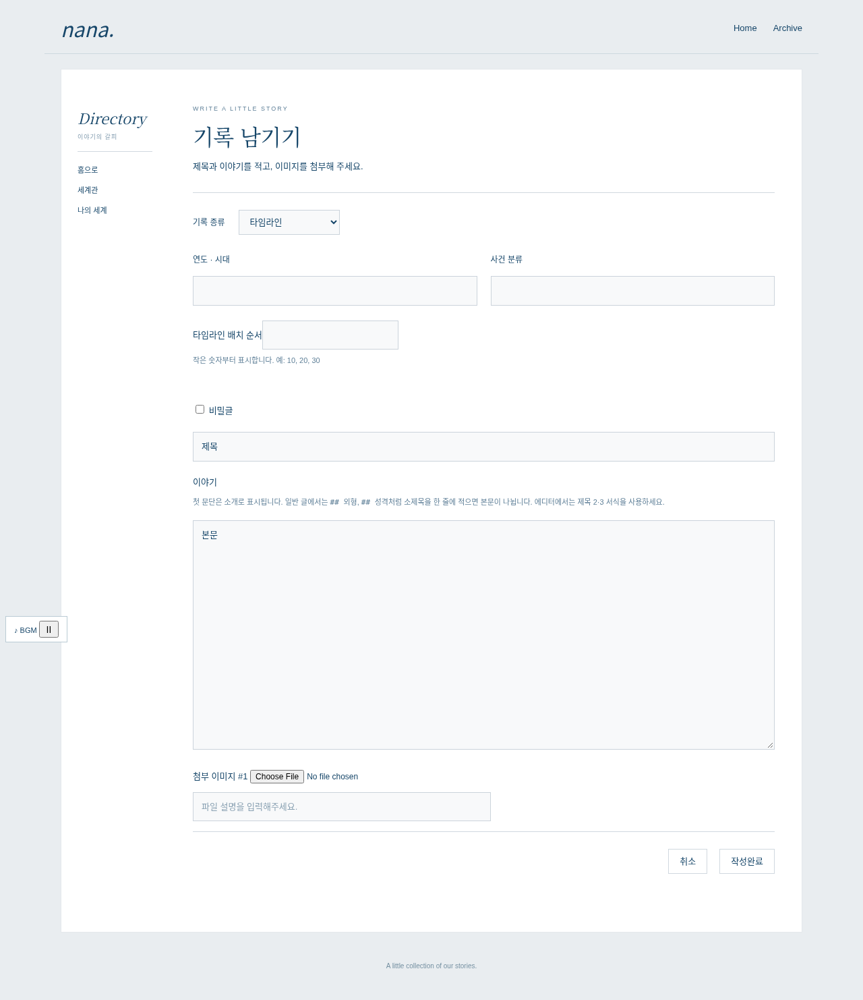

# nana_character v4 — 세계관과 OC를 한 게시판에

**타임라인과 캐릭터를 `nana_character` 스킨 하나, 게시판 하나에서 등록·관리합니다.** PHP 7.4용입니다.

**[통합 스킨 ZIP 다운로드](https://github.com/tjfwlswn33-debug/nana/raw/refs/heads/main/dist/nana-board-skins-v4.zip)** · [설치 안내](skin/INSTALL.md) · [원래 메뉴·BGM 연결](integration/README.md)

## 사용

1. `skin/board/nana_character`를 서버에 업로드합니다.
2. 게시판 하나에 `nana_character` 스킨을 적용합니다.
3. 목록에서 **타임라인 등록 / 캐릭터 등록**을 선택합니다. 글쓰기 화면에서도 기록 종류를 바꿀 수 있습니다.

별도 연표 게시판 ID 설정은 필요 없습니다. 기존 캐릭터 글은 그대로 표시합니다. 다른 게시판에 저장했던 연표는 엔진의 게시물 이동 기능으로 옮기고 종류를 타임라인으로 선택하면 됩니다. 기존 게시판을 먼저 삭제하지 마세요.

## 구성

- 흰색 박스, 소개 → 타임라인 이미지 → 캐릭터 목록
- 이미지 클릭 시 같은 게시판의 해당 사건·프로필로 이동
- 각 타임라인의 수정, 숫자로 지정하는 배치 순서
- 캐릭터 초상·소개·기본 정보·소제목별 긴 본문
- 두 종류의 별도 목록 집계·페이지·검색, 비밀글 정보 숨김
- 원래 엔진의 저장·업로드·권한·에디터·캡차 사용
- 원래 index/main의 메뉴·BGM 프레임을 유지하는 선택 연결 파일 포함

## 화면 예시

테스트용 콘텐츠·임시 헤더·음악 조작부입니다. 실제 사이트나 음원 재생 화면이 아닙니다.




## 검증

```sh
docker run --rm -v "$PWD:/app:ro" -w /app php:7.4-cli php tests/skin-test.php
docker run --rm -v "$PWD:/app:ro" -w /app php:7.4-cli php tests/archive-test.php
docker run --rm -v "$PWD:/app:ro" -w /app php:7.4-cli php tests/integration-test.php
```

Chromium 검사: `tests/fixtures/render.php`, `tests/fixtures/serve.py`, `tests/browser-test.js`. 실제 연결 파일의 브라우저 검사는 `tests/fixtures/build-shell.py`, `tests/shell-browser-test.js`를 사용합니다. Playwright·Chromium이 필요합니다. 320~1280px 표시, 단일 게시판의 종류 선택과 제출 데이터, 이동·목록 복귀, 원래 부모 메뉴·BGM 프레임 유지 여부를 확인합니다.

실제 DB 저장·음원 재생·커스텀 CSS 전체는 운영 테마와 함께 추가 확인이 필요합니다. 글쓰기 코드의 기반은 Gnuboard5 기본 스킨이며 GPL-2.0-or-later 조건을 따릅니다.
